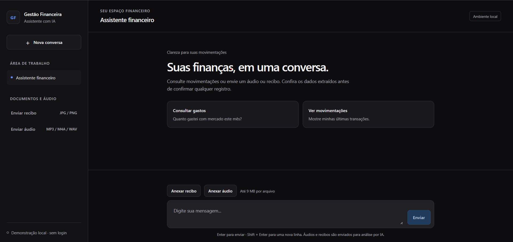

<div align="center">


<h1>GESTÃO FINANCEIRA IA</h1>

<p>
  <strong>KAIQUE JACOB</strong> · Java · Spring Boot · Spring AI · Groq · Gemini · MySQL
</p>

<p>
  Assistente financeiro multimodal com interface web e operações controladas pelo backend.
</p>

</div>

---

<div align="center">


</div>

## `SOBRE`

Aplicação de gestão financeira desenvolvida em Java 25 com Spring Boot 4 e Spring AI, composta por uma API REST e uma interface web em HTML, CSS e JavaScript.

O projeto permite consultar movimentações em linguagem natural e preparar registros financeiros a partir de áudios e imagens de recibos.

- 🎙️ Processamento de áudio: transcrição com Whisper e interpretação da intenção com Groq.
- 🧾 Análise de recibos: extração de descrição, valor e categoria com Gemini.
- 💬 Chat financeiro: consultas por linguagem natural com ferramentas somente de leitura.
- 🧠 Contexto conversacional: memória das mensagens recentes para interpretar perguntas de continuação.
- ✅ Confirmação de propostas: revisão dos dados antes de registrar uma transação sugerida pela IA.
- ⚖️ Comparação entre provedores: interpretação e latência de Groq e Gemini para a mesma mensagem.
- 🖥️ Interface web: chat, envio de arquivos e confirmação sem depender de comandos cURL.

As regras de negócio, os cálculos financeiros, o acesso ao banco e a persistência permanecem sob responsabilidade do backend.

Os dados são armazenados em MySQL 8.4. O código está organizado em camadas de domínio, aplicação e infraestrutura, com uso de entidades, value objects e contratos de persistência.

> Projeto de estudo e demonstração local. A versão atual não possui autenticação e não deve ser exposta publicamente com dados financeiros reais.


---

## `INTERFACE WEB`

<div align="center">



</div>

A interface é servida pelo próprio Spring Boot em `src/main/resources/static`.

1. Acesse `http://localhost:8080/`.
2. Faça perguntas sobre suas movimentações ou envie um recibo/áudio.
3. Revise a resposta ou a proposta gerada.
4. Confirme o registro somente quando os dados estiverem corretos.

Formatos aceitos: recibos JPG/PNG e áudios MP3, M4A/WAV. Arquivos são processados por provedores externos de IA; evite dados pessoais desnecessários.

---

## `FLUXO DA IA`

```text
                         INTERFACE WEB / API REST
                                   |
                 +-----------------+-----------------+
                 |                 |                 |
               Áudio             Recibo             Chat
                 |                 |                 |
          Groq / Whisper         Gemini        Groq + memória
          Speech-to-Text     Extração de dados       |
                 |                 |          Tool Calling
            Groq (JSON)            |          somente leitura
                 |                 |                 |
                 +--------+--------+          Consultas no MySQL
                          |                         |
                   Validação Java             Resposta em texto
                          |
                +---------+----------+
                |                    |
             Consulta             Proposta
                |                    |
          Resultado da API     Token de confirmação
                                     |
                              Revisão do usuário
                                     |
                              Confirmação explícita
                                     |
                              Persistência no MySQL
```

O áudio pode representar uma consulta ou uma proposta de registro. O recibo é utilizado para extrair uma proposta de transação.

O chat financeiro utiliza ferramentas de consulta. Ele não registra transações por meio de ferramentas de escrita.

---


## `SESSÕES E MEMÓRIA`

- Sessões da aplicação são armazenadas no MySQL.
- O chat mantém uma janela de até 20 mensagens em memória.
- O histórico é separado pela combinação `userId:sessionId`.
- Sessões expiram após 15 minutos sem uso.
- Tokens de confirmação expiram após 5 minutos.
- Histórico e tokens são perdidos quando a API é reiniciada.

O histórico ajuda na interpretação de perguntas de continuação, mas valores financeiros são consultados novamente pelas ferramentas do backend.

---

## `ENDPOINTS DA API`

Os endpoints de negócio exigem o header `X-User-Id` com um UUID. Esse identificador é informado pelo cliente e **não representa autenticação**.

| Operação | Método / Endpoint |
|---|---|
| Processar áudio | `POST /transactions/ai` |
| Processar recibo | `POST /transactions/ai/receipt` |
| Chat financeiro | `POST /transactions/ai/chat` |
| Sugerir categoria | `POST /transactions/suggest-category` |
| Comparar provedores | `POST /transactions/ai/compare` |
| Confirmar transação | `POST /transactions/{token}/confirm` |
| Criar transação | `POST /transactions` |
| Buscar por categoria | `GET /transactions/{category}` |

Recursos auxiliares:

| Recurso | Endereço |
|---|---|
| Interface web | `GET /` |
| Health check | `GET /actuator/health` |

Para manter o contexto, reutilize o `sessionId` retornado pela API:

```text
POST /transactions/ai/chat?sessionId=UUID_DA_SESSAO
```

---

## `COMO EXECUTAR`

### Pré-requisitos

- Docker e Docker Compose.
- Chaves da [Groq](https://console.groq.com/) e do [Google AI Studio / Gemini](https://aistudio.google.com/).
- Java 25 caso a aplicação seja executada localmente.

### Configuração

```powershell
Copy-Item .env.example .env
```

Preencha no `.env`:

```properties
GROQ_API_KEY=sua-chave-do-groq
GROQ_CHAT_MODEL=openai/gpt-oss-20b
GEMINI_API_KEY=sua-chave-do-gemini
GEMINI_CHAT_MODEL=seu-modelo-gemini-disponivel
```

O arquivo `.env` contém segredos e não deve ser versionado.

### Aplicação e banco com Docker

```bash
docker compose --profile docker up --build -d
```

Acesse `http://localhost:8080/`. Para acompanhar os logs:

```bash
docker compose logs -f app
```

Após alterações no código, reconstrua a imagem com o mesmo comando.

### Banco com Docker e aplicação local

```bash
docker compose up -d mysql
```

```powershell
.\gradlew.bat bootRun
```

O `.env` é usado pelo Docker Compose, mas não é carregado automaticamente pelo `bootRun`. Configure as chaves no ambiente da IDE ou do processo.

> Não execute a API local e o container da API simultaneamente na mesma porta.

---

## `TESTES`

Suíte padrão:

```bash
./gradlew test
```

No Windows:

```powershell
.\gradlew.bat test
```

Os testes cobrem domínio, serviços, sessões, confirmação de propostas, memória do chat, validação de respostas e integrações selecionadas. A avaliação de prompts da Groq pode ser executada com:

```bash
./gradlew groqEvaluationTest
```

Essa tarefa exige `GROQ_API_KEY` no ambiente do processo.

---

## `LIMITAÇÕES CONHECIDAS`

- Não há autenticação; `X-User-Id` pode ser alterado pelo cliente.
- A interface utiliza um UUID de demonstração fixo em `static/js/api.js`.
- Histórico do chat e tokens ficam em memória e são perdidos no reinício.
- Memória e tokens locais não oferecem coordenação entre múltiplas instâncias.
- Consumo do token e persistência não formam uma operação atômica.
- O áudio é enviado como arquivo; não há gravação pelo microfone.
- Respostas, disponibilidade e limites dependem dos provedores externos.
- A IA pode interpretar informações incorretamente; revise toda proposta antes de confirmar.

---

## `ESTRUTURA DO PROJETO`

```text
src/main/java/dio/budgeting/
├── domain/                  # Entidades, value objects e contratos
├── application/             # Casos de uso e serviços
│   ├── ai/                  # Interpretação, recibos e comparação
│   ├── input/               # Entradas
│   └── output/              # Saídas
└── infrastructure/
    ├── ai/                  # Configurações e integrações
    ├── http/                # Controllers, DTOs e erros
    └── persistence/         # JPA e repositórios

src/main/resources/
├── prompts/                 # Instruções dos modelos
└── static/                  # Interface web
```

---

## `ESTUDO COMPARATIVO`

O estudo Groq × Gemini está disponível em [`docs/ai-provider-comparison.md`](docs/ai-provider-comparison.md). Ele registra diferenças de interpretação, aderência ao JSON, latência, falhas observadas e ajustes de prompt.

---

## `EVOLUÇÕES PLANEJADAS`

```text
[ ] Cadastro de usuários e autenticação com Spring Security
[ ] Substituir X-User-Id pela identidade autenticada
[ ] Persistência do histórico do chat
[ ] Confirmação idempotente e durável
[ ] Gravação de áudio pelo navegador
[ ] Recuperação de conversas anteriores
[ ] Dashboard com gráficos
[ ] Testes automatizados da interface
```

---

## `TECNOLOGIAS`

<div align="center">

<pre>
[SYSTEM STATUS]

Language  : JAVA 25
Framework : SPRING BOOT 4 & SPRING AI
Frontend  : HTML, CSS & JAVASCRIPT
AI        : GROQ + GEMINI + WHISPER
Memory    : MESSAGE WINDOW / IN-MEMORY
Database  : MYSQL 8.4
Runtime   : DOCKER
Testing   : JUNIT 5 & MOCKITO
Build     : GRADLE

STATUS    : LOCAL_DEMO_READY

&gt; keep_learning();
&gt; keep_building();
</pre>

</div>

---

<div align="center">

### `SYSTEM // END`

Java • Spring Boot • Spring AI • Groq • Gemini • MySQL • Docker • HTML • CSS • JavaScript

</div>
