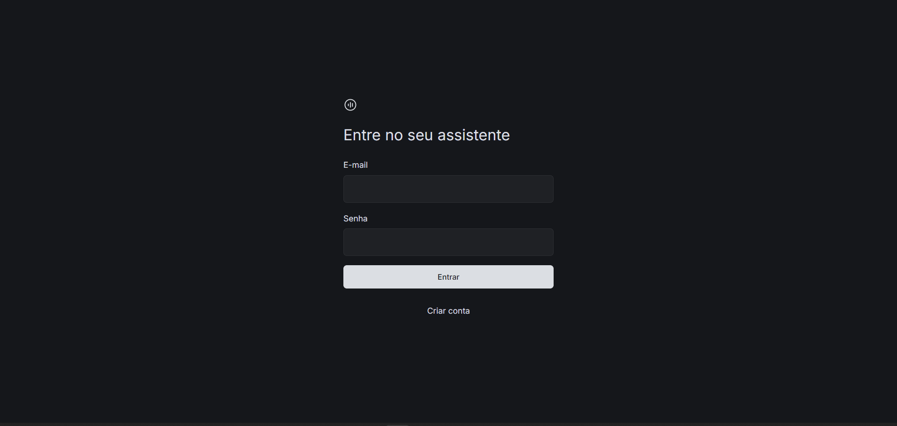

<div align="center">


<h1>GESTÃO FINANCEIRA IA</h1>

[](https://github.com/kaiquejacob/spring-ai-budgeting-api/actions/workflows/ci.yml)

<p>
  <strong>KAIQUE JACOB</strong> · Java · Spring Boot · Spring AI · Groq · Gemini · MySQL
</p>

<p>
  Assistente financeiro multimodal com interface web e operações controladas pelo backend.
</p>

</div>

---

<div align="center">


</div>

## `SOBRE`

Aplicação de gestão financeira desenvolvida em Java 25 com Spring Boot 4 e Spring AI, composta por uma API REST e uma interface web em HTML, CSS e JavaScript.

Com uma conta, você pode consultar suas movimentações em linguagem natural e preparar registros financeiros a partir de áudios e imagens de recibos. O Spring Security gerencia cadastro, login e logout por sessão. As senhas são armazenadas com BCrypt, e o backend usa a identidade da sessão para acessar as transações da conta.

- 🎙️ Processamento de áudio: transcrição com Whisper e interpretação da intenção com Groq.
- 🧾 Análise de recibos: extração de descrição, valor e categoria com Gemini.
- 💬 Chat financeiro: consultas por linguagem natural com ferramentas somente de leitura.
- 🧠 Contexto conversacional: memória das mensagens recentes para interpretar perguntas de continuação.
- ✅ Confirmação de propostas: revisão dos dados antes de registrar uma transação sugerida pela IA.
- ⚖️ Comparação entre provedores: interpretação e latência de Groq e Gemini para a mesma mensagem.
- 🖥️ Interface web: chat, envio de arquivos e confirmação sem depender de comandos cURL.

As regras de negócio, os cálculos financeiros, o acesso ao banco e a persistência permanecem sob responsabilidade do backend.

Os dados são armazenados em MySQL 8.4. O código está organizado em camadas de domínio, aplicação e infraestrutura, com uso de entidades, value objects e contratos de persistência.

> Projeto de estudo e demonstração local. Use dados de demonstração.


---

## `INTERFACE WEB`

<div align="center">


</div>

### Tela de acesso

<div align="center">



</div>

A interface é servida pelo próprio Spring Boot em `src/main/resources/static`, sem etapa de build. O JavaScript usa módulos ES em `static/js`, com a autenticação em `auth.js` e as requisições em `api.js`. Os tokens de design ficam em [`static/css/tokens.css`](src/main/resources/static/css/tokens.css). Consulte também o [DESIGN.md](DESIGN.md).

1. Acesse `http://localhost:8080/`.
2. Em **Criar conta**, informe seu e-mail e uma senha de pelo menos oito caracteres. Após o cadastro, a tela volta ao login com o e-mail preenchido.
3. Digite a senha e selecione **Entrar**. Se já tiver conta, comece por este passo.
4. Faça perguntas sobre suas movimentações ou envie um recibo ou áudio. Revise a proposta antes de confirmar o registro.
5. Para encerrar a sessão, selecione **Sair** junto ao seu e-mail.

**Recentes** lista as conversas da conta por data da última troca, da mais recente à mais antiga. Selecione uma conversa para ler suas perguntas e respostas em modo somente leitura. **Carregar mais** mostra outras conversas e **Carregar mais mensagens** exibe as próximas trocas do histórico. **Voltar ao assistente** retorna à área de envio de mensagens e arquivos.

Formatos aceitos: recibos JPG/PNG e áudios MP3, M4A/WAV. Arquivos são processados por provedores externos de IA; evite dados pessoais desnecessários.

---

## `FLUXO DA IA`

```text
                         INTERFACE WEB / API REST
                                   |
                 +-----------------+-----------------+
                 |                 |                 |
               Áudio             Recibo             Chat
                 |                 |                 |
          Groq / Whisper         Gemini        Groq + memória
          Speech-to-Text     Extração de dados       |
                 |                 |          Tool Calling
            Groq (JSON)            |          somente leitura
                 |                 |                 |
                 +--------+--------+          Consultas no MySQL
                          |                         |
                   Validação Java             Resposta em texto
                          |
                +---------+----------+
                |                    |
             Consulta             Proposta
                |                    |
          Resultado da API     Token de confirmação
                                     |
                              Revisão do usuário
                                     |
                              Confirmação explícita
                                     |
                              Persistência no MySQL
```

O áudio pode representar uma consulta ou uma proposta de registro. O recibo é utilizado para extrair uma proposta de transação.

O chat financeiro utiliza ferramentas de consulta. Ele não registra transações por meio de ferramentas de escrita.

---


## `SESSÕES E MEMÓRIA`

- **Sessão de login.** O Spring Security mantém a autenticação no servidor e a identifica pelo cookie `JSESSIONID`. É preciso fazer login novamente após reiniciar a aplicação.
- **Sessão de conversa.** O MySQL armazena a sessão e seu vínculo com a conta. A validade é renovada por 15 minutos ao usar uma sessão válida. Uma nova mensagem enviada sem `sessionId`, com um ID inexistente ou com uma sessão expirada da própria conta inicia outra sessão. O ID de outra conta é recusado.
- **Memória do modelo.** O chat usa uma janela de até 20 mensagens persistida via JDBC no MySQL, com a chave `userId:sessionId`. Essa janela dá contexto às perguntas de continuação. As ferramentas do backend consultam os valores financeiros novamente.
- **Histórico da conta.** Cada troca de texto concluída com uma resposta não vazia é gravada no MySQL como pergunta e resposta. O dono pode consultar as trocas mesmo depois que a sessão de conversa expira ou que a aplicação reinicia, desde que esteja autenticado. Abrir o histórico para leitura não renova a sessão nem retoma a conversa.

### Propostas e confirmação

As propostas são persistidas no MySQL e valem cinco minutos a partir da criação. Uma rotina remove periodicamente as propostas vencidas. O intervalo padrão é de cinco minutos e pode ser configurado com `budgeting.proposal.cleanup.interval`.

O consumo do token e a gravação da transação ocorrem na mesma transação de banco. Repetir uma confirmação bem-sucedida retorna `404` e não duplica a movimentação. Se a gravação falhar, o rollback mantém o token disponível para uma nova tentativa enquanto ele estiver válido.

---

## `ENDPOINTS DA API`

As rotas em `/transactions` e `/conversations` exigem uma sessão autenticada. O backend obtém o UUID da conta a partir da sessão.

### Autenticação e CSRF

| Método e rota | Entrada | Resposta |
|---|---|---|
| `GET /auth/csrf` | Sem corpo, acessível antes do login | `200` com `{ "headerName": "X-CSRF-TOKEN", "token": "..." }` |
| `POST /auth/register` | JSON com `email` e `password`, mais o header CSRF | `201` com `id` e `email`, `400` para dados inválidos ou `409` para e-mail duplicado |
| `POST /auth/login` | Formulário `application/x-www-form-urlencoded` com `email` e `password`, mais o header CSRF | `204` sem corpo, com renovação da sessão, ou `401` para credenciais inválidas |
| `GET /auth/me` | Cookie de sessão | `200` com `id` e `email` ou `401` sem sessão autenticada |
| `POST /auth/logout` | Cookie e header CSRF, sem corpo | `204` sem corpo, com encerramento da sessão |

Preserve o cookie `JSESSIONID` nas requisições ao mesmo servidor. No navegador,
o cookie é enviado pelo próprio navegador em requisições de mesma origem e tem
os atributos `HttpOnly` e `SameSite=Lax`. Antes do primeiro POST, obtenha o
token em `GET /auth/csrf` e envie-o no header indicado por `headerName`. O mesmo
header vale para uploads multipart. Após login ou logout, descarte o token
anterior e consulte `GET /auth/csrf` novamente antes da próxima escrita. Nas
rotas de negócio, `401` indica ausência de sessão autenticada e uma escrita
autenticada com CSRF ausente ou inválido recebe `403`.

Exemplo com PowerShell 7 para cadastro, login, consulta da conta e envio de
recibo. Use um e-mail novo para executar o cadastro pela primeira vez.

```powershell
$base = 'http://localhost:8080'
$email = Read-Host 'E-mail'
$password = Read-Host 'Senha' -MaskInput
$csrf = Invoke-RestMethod "$base/auth/csrf" -SessionVariable webSession
$headers = @{ ($csrf.headerName) = $csrf.token }

Invoke-RestMethod "$base/auth/register" -Method Post -WebSession $webSession -Headers $headers `
    -ContentType 'application/json' -Body (@{ email = $email; password = $password } | ConvertTo-Json)
Invoke-RestMethod "$base/auth/login" -Method Post -WebSession $webSession -Headers $headers `
    -ContentType 'application/x-www-form-urlencoded' -Body @{ email = $email; password = $password }
Remove-Variable password

Invoke-RestMethod "$base/auth/me" -WebSession $webSession
$csrf = Invoke-RestMethod "$base/auth/csrf" -WebSession $webSession
$headers = @{ ($csrf.headerName) = $csrf.token }
Invoke-RestMethod "$base/transactions/ai/receipt" -Method Post -WebSession $webSession -Headers $headers `
    -Form @{ file = Get-Item './recibo.png' }

Invoke-RestMethod "$base/auth/logout" -Method Post -WebSession $webSession -Headers $headers
$csrf = Invoke-RestMethod "$base/auth/csrf" -WebSession $webSession
$headers = @{ ($csrf.headerName) = $csrf.token }
```

### Transações

| Operação | Método / Endpoint |
|---|---|
| Processar áudio | `POST /transactions/ai` |
| Processar recibo | `POST /transactions/ai/receipt` |
| Chat financeiro | `POST /transactions/ai/chat` |
| Sugerir categoria | `POST /transactions/suggest-category` |
| Comparar provedores | `POST /transactions/ai/compare` |
| Confirmar transação | `POST /transactions/{token}/confirm` |
| Criar transação | `POST /transactions` |
| Buscar por categoria | `GET /transactions/{category}` |

Recursos auxiliares:

| Recurso | Endereço |
|---|---|
| Interface web | `GET /` |
| Health check (autenticado) | `GET /actuator/health` |
| Swagger UI (autenticado) | `/swagger-ui.html` |
| OpenAPI (autenticado) | `/v3/api-docs` |

Para manter o contexto de conversa, reutilize o `sessionId` retornado pela API
na mesma conta. Esse parâmetro é separado do cookie de autenticação.

```text
POST /transactions/ai/chat?sessionId=UUID_DA_SESSAO
```

### Histórico de conversas

Os dois endpoints usam o cookie de sessão `JSESSIONID`. A paginação começa em `page=0` e o tamanho padrão é `size=20`. O parâmetro `page` aceita inteiros a partir de 0 e `size` aceita inteiros de 1 a 100. Valores fora desses limites retornam `400`.

Em caso de sucesso, o HTTP `200` retorna um objeto com `items` (itens da página), `page` (índice da página), `size` (tamanho solicitado) e `hasNext` (indica se há outra página).

| Endpoint | Campos em cada item de `items` |
|---|---|
| `GET /conversations` | `conversationId` (UUID), `preview` (até 80 caracteres da primeira pergunta) e `lastExchangeAt` (data e hora da última troca). Lista as conversas da conta com histórico, da troca mais recente para a mais antiga. |
| `GET /conversations/{id}/messages` | `question` (pergunta), `answer` (resposta) e `exchangedAt` (data e hora da troca), em ordem cronológica. Retorna `404` se o ID for inexistente ou pertencer a outra conta. |

Sem uma sessão autenticada, ambos retornam `401`.

---

## `COMO EXECUTAR`

### Pré-requisitos

- Docker e Docker Compose.
- Chaves da [Groq](https://console.groq.com/) e do [Google AI Studio / Gemini](https://aistudio.google.com/).
- Java 25 caso a aplicação seja executada localmente.

### Configuração

```powershell
Copy-Item .env.example .env
```

Preencha no `.env`:

```properties
GROQ_API_KEY=sua-chave-do-groq
GROQ_CHAT_MODEL=openai/gpt-oss-20b
GEMINI_API_KEY=sua-chave-do-gemini
GEMINI_CHAT_MODEL=seu-modelo-gemini-disponivel
```

O arquivo `.env` contém segredos e não deve ser versionado.

### Aplicação e banco com Docker

```bash
docker compose --profile docker up --build -d
```

Acesse `http://localhost:8080/`. Para acompanhar os logs:

```bash
docker compose logs -f app
```

Após alterações no código, reconstrua a imagem com o mesmo comando.

### Banco com Docker e aplicação local

Para uma instalação nova ou dados de demonstração, provisione o schema vazio
`budgeting_login_dev` no MySQL do Compose e conceda acesso ao usuário da
aplicação. O Flyway aplica V1 a V8 na inicialização. Para usar um banco com
dados existentes, confira primeiro o [procedimento de migração](#migração-do-schema-mysql),
incluindo a checagem de transações órfãs antes da V4.

No PowerShell, inicie o serviço MySQL e aponte o Spring para o schema local:

```powershell
docker compose up -d mysql
.\gradlew.bat bootRun --args="--spring.docker.compose.enabled=false --spring.datasource.url=jdbc:mysql://localhost:3307/budgeting_login_dev"
```

Se o usuário do schema for diferente do padrão local, configure
`SPRING_DATASOURCE_USERNAME` e `SPRING_DATASOURCE_PASSWORD` no ambiente do processo.

O `.env` é usado pelo Docker Compose, mas não é carregado automaticamente pelo `bootRun`. Configure as chaves no ambiente da IDE ou do processo.

O fuso horário da aplicação é `America/Sao_Paulo`, configurado pela propriedade `app.timezone`.

> Não execute a API local e o container da API simultaneamente na mesma porta.

---

## `TESTES`

`./gradlew test` roda sem Docker, sem MySQL e sem chaves de API, usando H2 em memória. Os testes que acessam o Groq só executam quando `GROQ_API_KEY` existe; chamadas de integração ao Gemini dependem de `GEMINI_API_KEY`.

```bash
./gradlew test
```

No Windows:

```powershell
.\gradlew.bat test
```

Os testes cobrem domínio, serviços, sessões, confirmação de propostas, memória do chat, validação de respostas e integrações selecionadas. A avaliação de prompts da Groq pode ser executada com:

```bash
./gradlew groqEvaluationTest
```

Essa tarefa exige `GROQ_API_KEY` no ambiente do processo.


### Migração do schema MySQL

Em um banco vazio, o Flyway aplica da V1 à V8 na inicialização e o Hibernate
valida o schema. Em um banco legado, a V1 só pode ser marcada como baseline
depois da conferência abaixo. O baseline automático fica desativado. A V2
preenche `type` com `EXPENSE` e copia `created_at` para `occurred_at`, inclusive
quando o valor histórico é nulo.

A V5 cria a tabela de propostas pendentes, a V6 cria a tabela JDBC de memória do modelo, a V7 cria o histórico de trocas e a V8 indexa `pending_transactions.expires_at` para a limpeza periódica.

No cadastro manual, `POST /transactions` aceita `type` (`INCOME` ou `EXPENSE`)
e `occurredAt` (instante ISO 8601, como `2026-11-22T15:00:00Z`). Quando
omitidos, o padrão é `EXPENSE` e o instante de criação. Os totais por período
usam a data de ocorrência e as transações recentes são ordenadas pela criação.

Para demonstrar os cenários em MySQL 8.4 descartável, execute
`./gradlew mysqlMigrationTest` (`.\gradlew.bat mysqlMigrationTest` no Windows).
O Testcontainers cria bancos isolados, aplica V1 a V8 no banco vazio, demonstra
o baseline seguido da migração de um legado com conta correspondente e verifica
que uma transação órfã impede a V4 sem perder a linha. A suíte também cobre
reinício, isolamento, concorrência, rollback e a fronteira da limpeza de propostas.
O comando exige Docker disponível e falha se o Docker estiver indisponível.

Para preparar um banco legado, pause as escritas e confirme host, porta, schema
e usuário com a mesma conexão que será usada pelo Flyway. Nos exemplos Bash,
preencha `DB_HOST`, `DB_PORT`, `DB_USER` e `DB_NAME` com o destino conferido.
Use `mysql_config_editor` para configurar o login path `budgeting-baseline`.

```bash
mysql_target=(--login-path=budgeting-baseline --protocol=TCP --host="$DB_HOST" --port="$DB_PORT" --user="$DB_USER")
mysql "${mysql_target[@]}" "$DB_NAME" -e 'SELECT DATABASE(), @@hostname, @@port, @@server_uuid, CURRENT_USER(); SHOW TABLES;'
mysqldump "${mysql_target[@]}" --single-transaction --no-tablespaces --set-gtid-purged=OFF --result-file=budgeting-before-flyway.sql "$DB_NAME"
```

Valide o backup restaurando-o em outro banco descartável. Provisione também um
schema vazio em MySQL 8.4 com os mesmos padrões de charset e collation. Com a
CLI apontada para esse schema descartável, execute
`flyway -locations=filesystem:src/main/resources/db/migration -target=1 migrate`.
Compare o `SHOW CREATE TABLE` das duas tabelas do legado com o da V1,
incluindo colunas, tipos, nulabilidade, chaves, índices, UUIDs, enums e precisão
dos timestamps. Com `mysql_reference` configurado para o destino descartável
no login path `budgeting-reference` e `REFERENCE_DB` definido para o schema migrado:

```bash
mysql_reference=(--login-path=budgeting-reference)
ddl='SHOW CREATE TABLE conversation_sessions; SHOW CREATE TABLE transaction_entity;'
mysql "${mysql_target[@]}" --batch --raw --skip-column-names "$DB_NAME" -e "$ddl" > legacy-schema.sql
mysql "${mysql_reference[@]}" --batch --raw --skip-column-names "$REFERENCE_DB" -e "$ddl" > v1-schema.sql
diff -u v1-schema.sql legacy-schema.sql
```

Prossiga somente se os schemas coincidirem e o legado ainda não tiver a tabela
`flyway_schema_history`. Use a CLI do Flyway da mesma versão resolvida pelo
Gradle (`./gradlew dependencyInsight --dependency flyway-core --configuration runtimeClasspath`).
Configure `FLYWAY_USER` e `FLYWAY_PASSWORD` no ambiente da sessão para o destino
conferido e execute a partir da raiz do repositório:

```bash
export FLYWAY_URL="jdbc:mysql://${DB_HOST}:${DB_PORT}/${DB_NAME}"
flyway -locations=filesystem:src/main/resources/db/migration -baselineVersion=1 baseline
flyway -locations=filesystem:src/main/resources/db/migration info
mysql "${mysql_target[@]}" "$DB_NAME" -e 'SELECT version, type, success FROM flyway_schema_history ORDER BY installed_rank;'
```

Confira a linha `1 / BASELINE / 1` e aplique até a V3 para verificar se há
transações órfãs antes da V4. Em um banco já migrado até a V3, comece pela
conferência de órfãos.

```bash
flyway -locations=filesystem:src/main/resources/db/migration -target=3 migrate
mysql "${mysql_target[@]}" "$DB_NAME" -e '
  SELECT HEX(t.user_id) AS user_id, COUNT(*) AS transactions
  FROM transaction_entity t
  LEFT JOIN users u ON u.id = t.user_id
  WHERE u.id IS NULL
  GROUP BY t.user_id;'
```

A V4 exige que cada `transaction_entity.user_id` corresponda ao `users.id` de
uma conta existente. A consulta deve retornar zero linhas antes de aplicar a
V4. Se houver órfãos, interrompa a migração até identificar e provisionar as
contas reais com os UUIDs correspondentes. A V4 não altera as transações e
restringe a exclusão de contas que possuem transações.

Com o pré-requisito atendido, inicie a aplicação no mesmo destino para aplicar
as migrações pendentes até a V8 e validar o schema com o Hibernate. Antes de
retomar as escritas, confira em `flyway_schema_history` as versões 2 a 8 com
`type = SQL` e `success = 1`. Se você marcou a V1 como baseline, confira também
a linha `1 / BASELINE / 1`. Compare as colunas
originais com o backup e confira o preenchimento de `type` e `occurred_at`.

Para dados de demonstração, use o schema vazio `budgeting_login_dev` conforme
[a configuração local](#banco-com-docker-e-aplicação-local). Cadastre uma conta
pela interface e use-a para criar transações.

---

## `LIMITAÇÕES CONHECIDAS`

- A sessão de login fica no servidor e exige novo login após reiniciar a aplicação.
- O histórico disponível na interface é somente leitura. O contexto enviado ao modelo é limitado à janela de 20 mensagens.
- O áudio é enviado como arquivo; não há gravação pelo microfone.
- Respostas, disponibilidade e limites dependem dos provedores externos.
- A IA pode interpretar informações incorretamente; revise toda proposta antes de confirmar.

---

## `ESTRUTURA DO PROJETO`

```text
src/main/java/dio/budgeting/
├── domain/                  # Entidades, value objects e contratos
├── application/             # Casos de uso e serviços
│   ├── transaction/         # Registro e consulta de transações
│   ├── proposal/            # Propostas pendentes e confirmação
│   ├── conversation/        # Sessões, chat financeiro e ferramentas
│   ├── assistant/           # Intenções, áudio, recibos e categorias
│   └── ai/                  # Contratos de IA e provedores de texto
└── infrastructure/
    ├── ai/                  # Configurações e integrações
    ├── http/                # Controllers, DTOs e erros
    ├── persistence/         # JPA e repositórios
    └── time/                # Relógio e fuso horário

src/main/resources/
├── prompts/                 # Instruções dos modelos
└── static/                  # Interface web
```

---

## `ESTUDO COMPARATIVO`

O estudo Groq × Gemini está disponível em [`docs/ai-provider-comparison.md`](docs/ai-provider-comparison.md). Ele registra diferenças de interpretação, aderência ao JSON, latência, falhas observadas e ajustes de prompt.

---

## `EVOLUÇÕES PLANEJADAS`

```text
[x] Cadastro, login e logout com Spring Security e proteção CSRF
[x] Identidade autenticada nas rotas de transações
[x] Tela de acesso e chip do usuário com logout
[x] Chave estrangeira entre transações e contas
[x] Persistência do histórico do chat
[x] Confirmação atômica com token persistido e proteção contra duplicidade
[ ] Gravação de áudio pelo navegador
[x] Consulta de conversas anteriores em modo somente leitura
[ ] Dashboard com gráficos
[ ] Testes automatizados da interface
```

---

## `TECNOLOGIAS`

<div align="center">

<pre>
[SYSTEM STATUS]

Language  : JAVA 25
Framework : SPRING BOOT 4 & SPRING AI
Frontend  : HTML, CSS & JAVASCRIPT
AI        : GROQ + GEMINI + WHISPER
Memory    : MESSAGE WINDOW / IN-MEMORY
Database  : MYSQL 8.4
Runtime   : DOCKER
Testing   : JUNIT 5 & MOCKITO
Build     : GRADLE

STATUS    : LOCAL_DEMO_READY

&gt; keep_learning();
&gt; keep_building();
</pre>

</div>

---

<div align="center">

### `SYSTEM // END`

Java • Spring Boot • Spring AI • Groq • Gemini • MySQL • Docker • HTML • CSS • JavaScript

</div>
